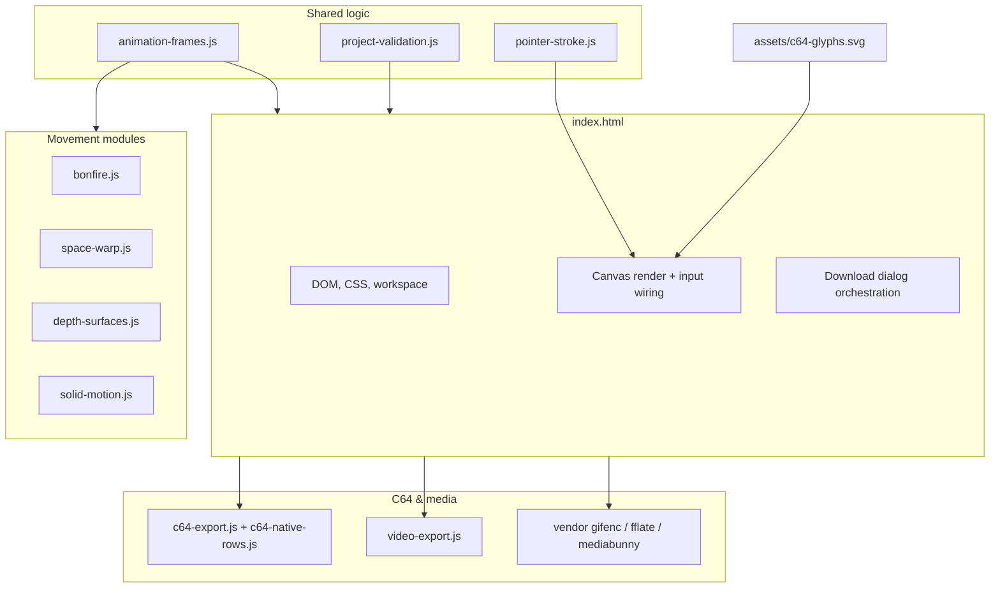

# Architecture overview

This page maps how [PETSCII Graphics Lab](https://funkatron.github.io/petscii-graphics-lab/) is put together. For behavioral contracts, see [AGENTS.md](../AGENTS.md) and the [maintainer reference](maintainer-reference.md).

## Deployment model

The editor is a **static site**: `index.html`, ES modules, `assets/c64-glyphs.svg`, and vendored encoders. GitHub Pages serves it with no backend. Autosave uses `localStorage` (`petscii-graphics-project-v3`).

## Module map

| Module | Responsibility |
| --- | --- |
| `index.html` | UI, grid state, undo, project I/O glue, canvas redraw, lazy export loading |
| `project-validation.js` | v3 JSON validation and shared animation enumerations |
| `animation-frames.js` | Frame plan, sampling budget, and per-frame cell/ink computation |
| `pointer-stroke.js` | Cell picking from pointer events and symmetric brush strokes |
| `c64-export.js` | PRG/D64 generation, timing diagnostics, adaptive program sizing |
| `bonfire.js`, `space-warp.js`, `depth-surfaces.js`, `solid-motion.js` | Individual movement effect math |
| `video-export.js` | WebCodecs video packaging via mediabunny |

## Data flow while drawing

1. SVG glyphs load into an in-memory bitmap table (`rom`).
2. Pointer events map to grid cells (`pointer-stroke.js`).
3. Each changed cell updates `grid`, `cellColors`, and optional `drawingReplay`.
4. `remember()` pushes an undo snapshot; `autosave` debounces to `localStorage`.

## Animation and export

1. `animationSettings()` reads the Animation sidebar.
2. `animationPlan()` / `animationCells()` in `animation-frames.js` produce frames for preview and downloads.
3. Preview is **read-only**; the source grid is restored when you choose **Return to drawing**.
4. GIF, frame ZIP, video, and C64 exports snapshot artwork first, then load encoders asynchronously.

## Testing

Playwright drives Chromium and two iPad WebKit profiles. Unit tests (`*.unit.mjs`) cover pure projection/validation without a browser. Optional `npm run test:vice` exercises downloaded PRGs under py65/VICE.

## Incremental modularization

Recent extractions (`project-validation.js`, `animation-frames.js`, `pointer-stroke.js`) keep `index.html` as the integration shell while moving testable logic into imports. Further splits should preserve static hosting (no bundler required for the main app).

**Style:** code in new modules is written in expanded, idiomatic JavaScript (named helpers, early returns, ordinary spacing). The large inline script in `index.html` is still compact for historical reasons; prefer readable formatting when touching extracted modules or adding new ones.
