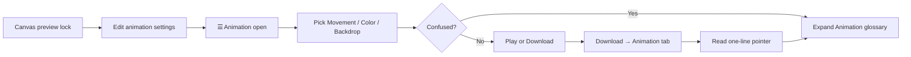

# Tier A UX — OODA plans (priority #3)

Review **one section at a time** before implementation. Housekeeping on the roadmap tracks completion of issue #66 and this queue.

**Order:** 1 → Reference overlay import · 2 → Export / scroller copy · 3 → Animation glossary

---

**Owner approval (2026-11-17):** **§1**, **§2**, and **§3** approved — implement in order 1 → 2 → 3. After Tier A merges, review [cell-editing-ooda-plan.md](cell-editing-ooda-plan.md) before individual cell editing work.

---

## Item 1 — Reference image overlay → PETSCII *(approved — shipped in overlay PR)*

### Observe

- Competitors (Marq overlay, Petmate guide PNG, Wizard JPG/PNG import) trace or convert a bitmap into the character grid.
- We have **text grid import**, **glyph picker**, and **no** raster overlay or auto-trace path today.
- v3 projects are a single grid; AGENTS forbids layer stacks unless explicitly scoped.
- Placement guidance: [editor-borrowings.md](editor-borrowings.md) — **Project** or **Canvas**; optional trace layer **not** in v3 JSON.

### Orient

- **Product goal:** faster onboarding, not lossless photo→PETSCII.
- **Constraints:** GitHub Pages static app; authentic C64/TED glyphs only; one undoable import; iPad-primary interactions; no new v3 fields without owner break.
- **Accuracy:** document limits (palette, 2×1 cells, no sub-pixel fidelity).
- **Risks:** scope creep (full Marq auto-convert), performance on large images, misleading “perfect trace” expectations.

### Decide (proposed scope — revise before build)

| In | Out (v1) |
| --- | --- |
| User picks a local image; semi-transparent overlay on canvas aligned to grid | Persistent layers in project JSON |
| Opacity + optional scale/position before **Apply as import** | Quarter-block / sub-cell modes |
| **Apply** samples image into nearest allowed glyphs + inks (documented heuristic) | ML or external API |
| Clear overlay; result is one `remember()` history entry | Separate animation timeline |

**Acceptance:** README + help state accuracy limits; Playwright applies a fixture PNG and checks deterministic cells on a tiny grid; overlay does not break zoom/pan or preview lock.

### Act (implementation sequence — after you approve)

1. Spike sampling heuristic in a new `reference-overlay.js` (unit tests on fixed RGB fixtures).
2. UI: **Canvas** or **Project** entry → file picker → overlay draw on top of grid (CSS/canvas, read-only until Apply).
3. Wire Apply → grid mutation; Cancel removes overlay only.
4. Regression: drawing, undo, autosave, export unchanged when overlay dismissed.
5. Docs: editor-borrowings checkbox + maintainer contract paragraph.

---

## Item 2 — Export copy (scroller / native program) *(approved — shipped in export-copy PR)*

### Observe

- Tier A asks for **scroller / native program labels** when **Scroll** + PRG align with Petmate habits ([editor-borrowings.md](editor-borrowings.md)).
- Tab label **Native program (PRG)** already shipped; **Movement** and **Backdrop effect** renamed.
- [c64-output.md](c64-output.md) and download panel notes may not mention **horizontal scroller**, **vertical scroller**, or effect slug filenames yet.
- Export filenames now include effect ids (`export-filename.js` on `main`).

### Orient

- **Copy-only** pass: no export bytes, no new effects.
- **Dynamic help:** when `animationEffect` resolves to scroll-x/y/diagonal, C64 download help could say “scroller-style program” where true.
- **Risk:** over-promising hardware DYCP; keep “style” language unless native path is literal scroll.

### Decide (proposed scope)

| In | Out |
| --- | --- |
| Contextual sentences in **Download → Native program** and/or `c64ExportHelp` when movement is scroll family | Renaming effect ids |
| Cross-link [c64-output.md](c64-output.md) for load/limit text | New export formats |
| README one-line on filename pattern (`project-effect-size`) | Full Petmate “9 scroller types” matrix |
| Playwright asserts help contains scroller hint when scroll-x + C64 tab visible | iPad-only physical copy review (manual) |

**Acceptance:** strings match visible control names; Chromium + one iPad layout snapshot or text assertion; no behavior change in PRG bytes.

### Act (after approval)

1. Inventory scroll-related effect ids and existing help nodes (`c64ExportHelp`, download dialog).
2. Add small `updateExportCopy()` hook tied to animation settings (mirror pattern of other contextual controls).
3. Patch `c64-output.md` + README export section.
4. Add focused spec `export-copy.spec.cjs` or extend `project-naming`/`cleanup` minimally.

---

## Item 3 — Animation glossary *(approved — implemented in glossary PR)*

### Observe

- Borrowings recommend a short primer: effects **generate** frames; users need not paint every frame ([editor-borrowings.md](editor-borrowings.md)).
- Sidebar **Animation** already has three fieldsets (**Timeline & preview**, **Movement**, **Color**, **Backdrop**) plus one long **About replay & speed** disclosure (`#animationInfo`).
- Download sheet has **Animation** tab with `motionSummary`, preview, and frame ZIP copy that mentions numbered PNGs — but nothing explains **Wizard frame bar vs our effect stack**.
- `previewBanner` + **Animation settings** jump exists during canvas preview; glossary should be reachable without leaving preview.

### Orient — design goals

| Goal | How |
| --- | --- |
| Wizard/Petmate refugees “get it” in &lt;30 s | Lead with *generated frames*, not hand-painted cels |
| No mode error | Glossary is read-only; never changes `animationEffect` |
| iPad-first | Collapsed by default; no new scrolling region inside settings scroller |
| One source of truth | Same bullet text in sidebar + optional mirror line on Download → Animation tab |

**Do not** duplicate the entire `animationInfo` paragraph; glossary = vocabulary, **About replay & speed** = timing/cycles math.

### User paths (where glossary fits)



**editAnimation** (download sheet and preview banner) already closes the dialog, opens `#animationDetails`, and scrolls the sidebar — glossary lives in that same group, so refugees land next to the vocabulary after tapping **Edit**.

### UI placement (primary)

Insert in `index.html` **after** `#animationWarning`, **before** the existing “About replay & speed” `<details>` (sibling inside `#animationDetails .group-body`):

```html
<details class="help-disclosure" id="animationGlossary">
  <summary>Animation glossary</summary>
  <dl class="note glossary-list">
    <!-- dt/dd pairs — see draft copy below -->
  </dl>
  <p class="note">From other editors: Petmate <em>screens</em> are one grid plus effect settings, like our Movement and Color choices in one project. Wizard <em>Shift</em> is similar to Paint mode <strong>Glyph only</strong> / <strong>Ink only</strong> on the drawing strip — not a separate animation timeline.</p>
</details>
```

**CSS:** Reuse `.help-disclosure` and `.note` only; if `<dl>` needs tighter spacing, add `.glossary-list` in `styles/editor.css` (margin on `dt` only — no new colors or fonts).

**DOM ids to avoid:** Do not reuse `motionSummary` / `exportScrollerNote` (download dialog duplicates are separate nodes).

**Why here:** User is already choosing Movement / Color / Backdrop; glossary explains those words before they open exports.

**Why not Help sidebar:** Animation vocabulary is contextual; Help stays general drawing tips.

**Why not only Download tab:** Users configure effects in ☰ → Animation first; hiding glossary only in downloads misses the “aha” moment.

### UI placement (secondary — optional v1)

Under **Download artwork → Animation** tab (`#export-motion`), append to the `.note` below **Download frame ZIP** (line ~123 today):

> Effects in ☰ **Animation** settings build every frame automatically. Open **Animation glossary** there for a short primer.

Keep `#exportScrollerNote` (scroller exports) as its own dynamic note above the format row — glossary does not replace it.

No link that scrolls the sidebar on phone overlay (fragile); name the control path in plain text.

### Content outline (match visible control names)

Use a definition list (`<dl>`) for screen-reader-friendly pairs. **Draft v1 copy** (freeze in PR; tweak only for accuracy):

| `<dt>` (visible) | `<dd>` (one short paragraph each) |
| --- | --- |
| Generated frames | **Movement**, **Color animation**, and **Backdrop effect** are combined into every frame of one loop. You paint the source grid once; preview and exports play the result. |
| Replay drawing | **Replay drawing** follows the order you painted, erased, and repainted. It is not a hand-timed cel strip like a frame bar in some editors. |
| Loop duration and cycles | **Loop duration** (under **Timeline & preview**) is the full loop in seconds. **Movement cycles**, **Color cycles**, and **Backdrop cycles** run at their own rates inside that loop (up to 16× per loop). |
| Glyph, ink, and background | Each cell has a **glyph** and **ink** color. **Background** under **Colors** is the shared canvas brush color behind empty cells. |
| Backdrop effect | **Backdrop effect** animates empty-cell paper (and optional border lead on VIC). It is separate from the brush **Background** color. |
| Preview vs drawing | **Play** / **Return to drawing** and the preview banner lock the canvas while you watch. **Return to drawing** restores painting without changing your art. |
| Exports | **GIF**, **Video**, and **PNG frames (.zip)** match the preview timeline. **Native program (PRG)** and disk images run the same animation on real hardware when export succeeds. |
| Frame ZIP | **Download frame ZIP** saves numbered PNGs plus timing data for other tools. There is no in-editor cel timeline yet (planned separately). |

**From other editors** (single compact `<p class="note">` at bottom):

- Petmate *screens* ≈ our effect combinations, not separate project files.
- Wizard *Shift* ≈ Paint mode **Glyph only / Ink only** (drawing strip).

### Interaction and chrome

| State | Behavior |
| --- | --- |
| Collapsed (default) | Zero layout shift in Animation group |
| Expanded | `details[open]` only; does not auto-open on first visit (no nag) |
| Preview lock | Glossary remains readable; controls inside Movement stay disabled like today |
| Machine change | No machine-specific glossary body in v1 (backdrop bullet already mentions VIC generically) |

**Accessibility:** `summary` text exactly **Animation glossary**; inner headings are `<dt>` with plain language, not ALL CAPS.

### Relationship to existing help

| Existing | After glossary |
| --- | --- |
| `#animationInfo` “About replay & speed” | Keep; add one line at top: *For terms, open **Animation glossary** above.* |
| Contextual `?` popovers on download | Unchanged |
| README “Preview an animation” | Add one sentence linking glossary location |

### Visual hierarchy (sidebar Animation)

```
Animation (details)
├── Timeline & preview (fieldset)
├── Movement (fieldset)
├── Color (fieldset)
├── Backdrop (fieldset)
├── [warning note if any]
├── Animation glossary (details)  ← NEW
└── About replay & speed (details)
```

### Tests (when approved)

| Check | Project |
| --- | --- |
| Expand glossary, assert 3+ `<dt>` strings | Chromium |
| Collapsed by default on load | Chromium |
| Open ☰ → Animation at 200% font, expand glossary in viewport | `ipad-portrait` |
| Preview playing: glossary still expandable, Movement select stays disabled | Chromium |

Spec file: `tests/animation-glossary.spec.cjs`.

### Out of scope (reminder)

- Cel timeline / frame bar UI (Tier B).
- Tooltip on every Movement `<option>`.
- Embedding glossary in v3 JSON.

### Decide (scope lock for v1)

| In | Out |
| --- | --- |
| `#animationGlossary` + copy outline above | Download-tab-only glossary |
| Cross-line in `animationInfo` + README | Rewriting full animationInfo |
| Playwright spec | Video / screenshot marketing |

**Acceptance:** Owner sign-off on this section, then implement in one PR with docs + iPad reach assertion.

### Act (after §3 approval)

1. Land copy in `index.html` (English prose frozen before tests).
2. Add tests; run Chromium + iPad portrait.
3. Update `editor-borrowings.md` “Suggested help sidebar” to point at shipped control name.
4. Roadmap Tier A glossary checkbox.

---

## After Tier A

Per [roadmap.md](roadmap.md), **done when** Tier A checkboxes are green and iPad WebKit spot-checks pass on changed strings. Then Tier B (line/rect, show grid label, etc.) or priority **#1** animation prototypes per owner choice.